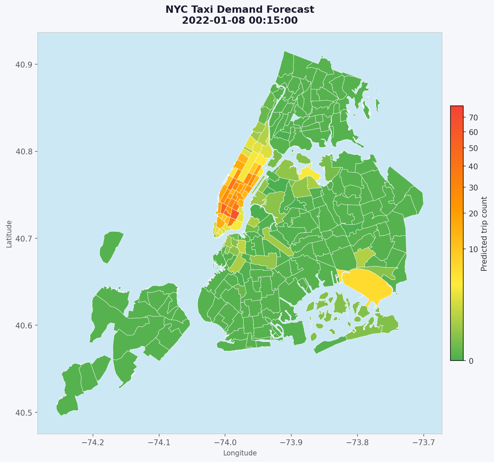

# where-next-nyc

> An operational 15-minute demand-forecasting system for NYC yellow-taxi drivers.

[](https://github.com/rururudolph145/where-next-nyc/actions/workflows/lint.yml)

## The Problem

NYC yellow-taxi drivers spend roughly **a third of their shift empty** — circling, idling, or returning from outer-borough drop-offs to areas they *guess* will be busy. Guessing well is a learned skill that takes years; guessing poorly compounds into lower revenue, longer shifts, and worse service for riders who can't find a cab.

Experienced drivers already know Midtown is busy at 5 pm. The hard question is the one they *can't* answer from intuition: **where will demand be 30 minutes from now**, when I finish this drop-off — accounting for weather shifts, event let-outs, weekday-vs-holiday rhythms, and the slow drift of neighbourhoods as the city changes?

## What This System Does

This repository is an **end-to-end demand forecasting system** for NYC yellow taxis. It predicts pickup volume per taxi zone for the next 30 minutes, refreshed every 15 minutes, and serves the result as a ranked heatmap a driver app can render in one API call.

- **Audience.** Drivers / fleet dispatchers who decide *where to position next*, not *what to do right now*.
- **Decision horizon.** 30 minutes — roughly the time it takes to finish a trip and reposition.
- **Resolution.** Per taxi zone (263 zones), per 15-minute bucket — matches the granularity of the decision.
- **Counterfactual claim.** The model is meant to beat what an experienced driver already knows (the obvious time-of-day pattern). Lift is measured against a *last-week-same-hour* baseline, not against zero.

## Sample Output

Three consecutive 15-minute refresh ticks render to the same choropleth a driver's app would draw from one `/heatmap` call. All three frames share a single fixed colour scale — nothing is re-normalised per image — so any drift you see between frames is real movement in predicted demand, not a plotting artefact.

| 00:00 | 00:15 | 00:30 |
|---|---|---|
|  |  |  |

> **What to look for:** demand concentrates in a handful of high-pickup zones (the red/orange clusters) while most of the city stays cool. At these short 15-minute steps the shift is deliberately subtle — the interesting contrast is *across the day*, when peak and off-peak hours reorder the top zones entirely. Regenerate these frames for any watermark position with `uv run python scripts/render_heatmap_samples.py`.

## How Value Is Measured

Model-quality metrics (MAE / RMSE / WAPE) measure the model. They don't measure whether a *driver who follows the heatmap* is better off. Two bridging metrics tie the ML output back to the business question:

| Metric | What it asks |
|---|---|
| **WAPE lift over baseline** | How much better is LightGBM than "last week, same hour, same zone"? |

Rather than absolute RMSE that fails to measure severity of mistaken prediction in smaller-demand-area, we opt to use WAPE that is more robust and scale-invariant.

Any challenger model must beat the previous champion model by > 2% WAPE
Any model must be able to beat the baseline by 15%

Analysis of this proof of concept is in the /experiment/rolling_retrain_eval.ipynb 

## How the Demo Works (Watermark-Driven Simulation)

Because the underlying TLC data is published on a 1–2 month lag, the system can't run against a live feed — but it *can* run end-to-end over the fixed 2021 timeline, exercising the exact same code path a production deployment would. This is the only way to credibly demonstrate a 15-minute-refresh system from a portfolio repo.

**The data watermark *is* the simulation position.** There is no wall-clock speedup and no background timer. A control file — `data/watermarks/refresh_15min/.current_watermark` — records how far along the 2021 timeline the pipeline has advanced. Each Airflow DAG run:

1. reads the watermark,
2. checks whether any new data exists past it (stops cleanly if not),
3. ingests the next 15-minute slice into Bronze (a **cumulative** window, so Bronze grows monotonically),
4. validates → features → predicts → logs the prediction,
5. advances the watermark and writes it back.

Because the watermark is only written on success, a mid-run crash leaves it untouched and the next run safely re-does the slice — the pipeline is crash-safe and idempotent at the slice boundary.

**What this lets a reviewer do:** `make airflow-up`, then fire `make demo-tick` repeatedly. Each trigger walks the timeline forward by one 15-minute slice. `curl /heatmap` between ticks shows the ranked zones for the current bucket, and `GET /health` reports the `simulated_now` derived from the watermark and the data publication lag — nothing is hidden.

> **Note on the `Clock` abstraction.** `app/core/clock.py` provides a `Clock` protocol (`WallClock` for production, `SimulatedClock` for tests) and remains the *only* legitimate caller of `datetime.now(...)` in the codebase. An earlier design drove the demo with a speed-up clock; that was replaced — the watermark model above is simpler and avoids the process-global state that made the clock approach fragile.

### Business-level evaluation (deferred)

A running system does **not** prove that drivers following the heatmap are better off. That requires a closed-loop harness with synthetic drivers replaying a held-out week (`HeatmapFollower` vs a `LastWeekFollower` baseline vs a `Stationary` control), measuring trips served, idle time, and fare lift. This **outcome harness is a roadmap item, not yet implemented** — the recall@K and WAPE-lift metrics above are the current basis for the value claim.

## Honest Limitations

- **Data publication lag.** NYC TLC publishes trip records on a 1–2 month lag. This repo treats the data as if it streamed in real time; the 15-minute refresh cadence is *simulated*, not live. A production deployment would need an upstream telemetry feed.
- **Single-agent assumption.** The model predicts demand as if the heatmap did not itself change driver behaviour. It does **not** model demand-supply equilibration — if every real driver flocked to the same top zone, the prediction would self-defeat. Capturing that requires the deferred outcome harness plus a supply-aware demand model.
- **Macro patterns only.** The model captures temporal + spatial regularities. It does not yet incorporate weather, events, or transit disruptions — the cases where intuition most often fails. Those are roadmap items.

Built with **LightGBM**, tracked with **MLflow**, served via **FastAPI**, orchestrated with **Airflow** 

(Simulation is watermark-driven, walking the 2022 timeline one 15-min slice per DAG run), and organised as a Bronze / Silver / Gold data pipeline.

## Current Forecasting Design

| Knob | Value | Meaning |
|---|---|---|
| Bucket width | `15min` | Demand is aggregated into 15-minute bins per zone |
| Refresh cadence | every 15 min | A new prediction is issued at the start of each bucket |
| Target | `target_sum_t1_t2` | Sum of the next two 15-min bins = **demand over the next 30 minutes** |
| Lag features | 15min, 30min, 1h, 2h, 3h, 6h, 1d, 1w | Bucket-aligned lags of `trip_count` per zone |
| Spatial smoothing | k=5 neighbour-mean of `lag_1` | Borrows recent demand signal from the 5 geographically nearest zones (BallTree haversine) |

At time `t`, the model is shown the bucket counts up to `t` (the most recent one being `[t-15, t)`) and predicts the **cumulative pickups over `[t, t+30)`**. Strictly this is still a *nowcast* — the target window starts at `t`, so the first 15 minutes is observable-in-progress — but the `[t+15, t+30)` half is genuinely future-unknown at prediction time, so the signal is useful for driver lookahead.

A true *shifted-horizon* forecast (`[t+30, t+45)` only, no overlap with `t`) is one config flip away via the already-shipped `feature.horizon_buckets` knob (PBI A3). See `implementation_checklist/pbi_tracker.md` for the full PBI history.

## Data Pipeline (medallion architecture)

```
raw/  ──► bronze/  ──► silver/  ──► gold/  ──► model + predictions
 │           │            │           │
 │           │            │           └─ feature engineering: bucket aggregation,
 │           │            │              cyclical time, lag features, neighbour
 │           │            │              smoothing, summed-horizon target
 │           │            └─ cleaning: drop nulls, anomalous pickups, negative-duration trips
 │           └─ schema-enforced consolidation of all monthly files
 └─ daily parquets from TLC (one per day, organised by YYYY_MM/)
```

### Cleaning scope

- Drop trips with pickup outside NYC bounds
- Drop trips with negative duration (dropoff before pickup — corrupt records)
- Drop rows with nulls in the columns listed in `clean.null_subset`

Anomalous trip-attribute outliers (speed, distance, fare) are **out of scope** for this model — they don't materially affect zone-level demand prediction.

## Repository Layout

```
app/                       Production source
├── ingestion/             ingest.py · clean.py · feature.py · schema.py (Pandera)
├── training/              trainer.py · baseline.py · registry_gate.py
├── inference/             predictor.py · simulator.py
├── monitoring/            prediction_log.py · actuals_join.py
├── api/                   FastAPI app — GET / · /heatmap · /health · /model-info
└── core/                  config · clock · paths · watermark · logging · metrics

orchestration/             Airflow 2.10.3 stack (docker-compose, container-only)
├── dags/                  15_minute_refresh_inference_dag (8-task watermark chain)
└── lib/                   *_helpers.py — Airflow-free DAG logic (host-testable)

pipeline/                  Standalone batch orchestrator (whole-dataset, no Airflow)
├── 00_seed_raw.py         split monthly Bronze parquet into daily raw files (setup)
├── 00_seed_march.py       download + seed March 2021 (setup)
├── 01_ingest.py           raw daily parquets → Bronze
├── 02_clean.py            Bronze → Silver
├── 03_feature.py          Silver → Gold
├── 04_train.py            Gold → LightGBM model (+ MLflow)
├── 05_inference.py        model + Gold → predictions table
├── 06_simulate.py         hourly inference replay over an out-of-sample window
└── run_all.py             runs steps 01→04 (ingest → clean → feature → train)

tests/                     pytest suite (~445 tests, including E2E on synthetic data)
docs/                      System design + smoke-test reports (HTML) + ADRs
implementation_checklist/  PBI tracker — single source of truth for design decisions
config.yml                 All runtime configuration (paths, lags, model params, …)
```

> **Invariant:** `app/` must never import from `orchestration/` — the domain code is orchestrator-agnostic, and a test enforces it. DAG task bodies stay thin; the real logic lives in `orchestration/lib/*_helpers.py` so it can be unit-tested without Airflow.

> **Two orchestrators, one set of domain code.** `pipeline/` and `orchestration/` are independent ways to drive the same `app/` classes. `pipeline/` is a dependency-free, single-process **batch** run over the whole dataset — ideal for a from-scratch train or a quick local reproduction with no Docker. `orchestration/` is the **incremental** Airflow demo that advances the watermark one 15-min slice per run. Both prove the domain code is orchestrator-agnostic.

## Setup

This project uses **[uv](https://github.com/astral-sh/uv)** for environment and dependency management. Python 3.13 required.

```bash
# Install uv if you don't have it
curl -LsSf https://astral.sh/uv/install.sh | sh

# Sync the venv from pyproject.toml + uv.lock
uv sync
```

## Run

There are two ways to drive the pipeline. Both run the identical `app/` domain code.

### Option A — Standalone batch (no Docker)

The `pipeline/` orchestrator runs each stage in-process over the whole dataset. Best for a clean train from scratch or a quick local reproduction.

```bash
# One-time: seed the raw daily-file layout from the bulk download
uv run python pipeline/00_seed_raw.py       # split monthly Bronze into daily raw files
uv run python pipeline/00_seed_march.py     # add March 2021

# Full run: ingest → clean → feature → train
uv run python -m pipeline.run_all

# …or one stage at a time
uv run python pipeline/01_ingest.py
uv run python pipeline/02_clean.py
uv run python pipeline/03_feature.py
uv run python pipeline/04_train.py
uv run python pipeline/05_inference.py       # produce the predictions table
uv run python pipeline/06_simulate.py        # hourly out-of-sample replay
```

> `run_all` stops after training (steps 01–04). Run `05_inference` afterwards to generate the predictions table the `/heatmap` endpoint serves.

### Option B — Incremental Airflow demo (watermark-driven)

Executes the full Bronze → Silver → Gold → predict path one 15-minute slice per trigger, walking the 2021 timeline.

```bash
# One-time: seed the raw daily-file layout (same as Option A)
uv run python pipeline/00_seed_raw.py
uv run python pipeline/00_seed_march.py

# Start the Airflow stack (container-only)
cp orchestration/.env.example orchestration/.env   # first time only
make airflow-init
make airflow-up

# Walk the 2021 timeline: each tick advances one 15-min slice
make demo-tick        # repeat to step the watermark forward
make airflow-down     # (or make demo-stop) to tear down
```

If a DAG doesn't appear in the Airflow UI, check for swallowed import errors first:

```bash
docker compose -f orchestration/docker-compose.yaml \
  exec airflow-scheduler airflow dags list-import-errors
```

## Serve

```bash
# Static demo: serve the latest cached predictions on :8000
make demo             # = uv run uvicorn app.api.main:app --host 0.0.0.0 --port 8000
```

Endpoints:

- `GET /heatmap` — latest per-zone predictions (`pulocationid`, `zone_name`, `predicted_trip_count`, `bucket_time`), sorted descending by demand.
- `GET /health` — service health + data freshness (`simulated_now`, publication lag), read from the watermark.
- `GET /model-info` — Production model provenance from the MLflow registry.

Interactive docs are at `http://localhost:8000/docs`.

## MLflow UI

```bash
uv run mlflow ui
# Then: http://localhost:5000
```

Training runs log model params, training/val/test metrics (MAE, RMSE, MAPE, WAPE), and the model artifact under experiment `ny_taxi_demand_model`.

## Test

```bash
uv run pytest                              # full suite (~445 tests)
uv run pytest tests/test_feature.py -v     # one module
uv run pytest tests/test_e2e_synthetic.py  # end-to-end smoke on synthetic data

# Quality gates (enforced in CI)
uv run ruff check .
uv run ruff format --check .
uv run mypy app tests                      # orchestration/ is excluded
```

## Configuration

All runtime knobs live in `config.yml`. Highlights:

| Section | Key | Purpose |
|---|---|---|
| `ingest` | `start_year_month` / `end_year_month` | Date range to pull from raw |
| `feature` | `bucket` | Aggregation bin width (`"15min"`, `"30min"`, `"h"`) |
| `feature` | `lags` | Lag offsets in *buckets* |
| `feature` | `horizon_sum_buckets` | N future buckets to sum into the target (PBI B2) |
| `feature` | `horizon_buckets` | Single-bucket shifted-horizon target (PBI A3) |
| `feature` | `n_neighbors` | k for spatial neighbour-mean smoothing (PBI B1) |
| `model` | `params` | LightGBM hyperparameters |
| `train` | `features` / `target` | Feature list + target column name |

The legacy keys `feature.lag_hours` and `bucket: "h"` remain accepted for back-compat with older configs and notebooks.

## Docker

```bash
docker build -t ny-taxi-demand .
docker run -p 80:80 ny-taxi-demand
```

## Documentation

- `docs/design_t30_15min_refresh.html` — t+30 / 15-min refresh design (B-track rationale)
- `docs/orchestration_services_overview.html` — Airflow stack topology
- `docs/pbi25b_refresh_15min_dag_summary.html` — the watermark-driven refresh DAG
- `docs/phase6_smoke_test_report.html` — end-to-end smoke report
- `docs/adr/` — architecture decision records
- `implementation_checklist/pbi_tracker.md` — PBI history, dependencies, priority order

## Roadmap

| Phase | Scope | Status |
|-------|-------|--------|
| 1 | Experimental notebook (data exploration, model prototyping) | ✅ done |
| 2 | Project structure (train → inference → `/heatmap`) | ✅ done |
| 3 | Additional features + 15-min bucket for 15-min refresh (B-track) | ✅ done |
| 4 | API layer (FastAPI: `/heatmap`, `/health`, `/model-info`) | ✅ done |
| 5 | MLflow layer (tracking, registry, champion-vs-challenger gate, fallback) | ✅ done |
| 6 | GitHub Actions CI (lint + test) | ✅ done |
| 7 | Airflow orchestrator layer (watermark-driven 15-min refresh DAG) | ✅ done |
| 8 | Monitoring (prediction log ✅ · drift detector · alerts · monitor DAG) | ⏸ deferred |
| 9 | Operational fast-forward (walk the 2021 timeline via `make demo-tick`) | ✅ done |
| 10 | Portfolio submission polish (lift numbers, methodology ADR, error-analysis, one-command bring-up) | ⏳ in progress |
| 11 | Load testing (latency SLO baseline + CI guard) | ⏸ deferred |

Legend: ✅ done · ⏳ in progress · ⏸ deferred by design. See [`implementation_checklist/pbi_tracker.md`](implementation_checklist/pbi_tracker.md) for per-PBI status, dependencies, and rationale.

## Tech Stack

| Layer | Tool | Role |
|---|---|---|
| Language / runtime | **Python 3.13**, **uv** | Fast, reproducible env; `uv.lock` committed |
| Data processing | **pandas**, **pyarrow**, **Parquet** | Medallion Bronze/Silver/Gold on parquet |
| Schema validation | **Pandera** | Bronze→Silver schema gate (PBI 19) — halts on TLC schema drift |
| Geospatial | **geopandas**, **scikit-learn** BallTree | Zone shapefile + haversine k-NN spatial smoothing |
| ML model | **LightGBM** | Tabular gradient boosting — beats XGBoost on this shape of data |
| Experiment tracking | **MLflow** | Params, metrics, model registry, champion-vs-challenger gate |
| API serving | **FastAPI**, **uvicorn** | `/heatmap`, `/health`, `/model-info` |
| Orchestration | **Apache Airflow 2.10.3** | Watermark-driven 15-min refresh DAG (LocalExecutor, container-only) |
| Containerisation | **Docker**, **docker-compose** | Airflow stack + reproducible service boot |
| Testing | **pytest**, **pandera** | ~445 tests: unit + AAA + E2E on synthetic data |
| Quality gates | **ruff**, **mypy** | Enforced in GitHub Actions on every PR |
| CI/CD | **GitHub Actions** | Lint + test workflows (PBI 30) |

**Deliberate non-choices:**
- **No cloud provider** — the entire stack runs on one laptop via docker-compose. Portfolio scope, not a scale demo.
- **No streaming (Kafka / Flink)** — inference is batch by nature (needs *aggregates* over closed windows). Streaming ingestion would help; streaming inference wouldn't.
- **No Celery / KubernetesExecutor** — LocalExecutor is the honest topology for a single-machine demo. Upscaling is documented in `docs/adr/` for when it matters.
